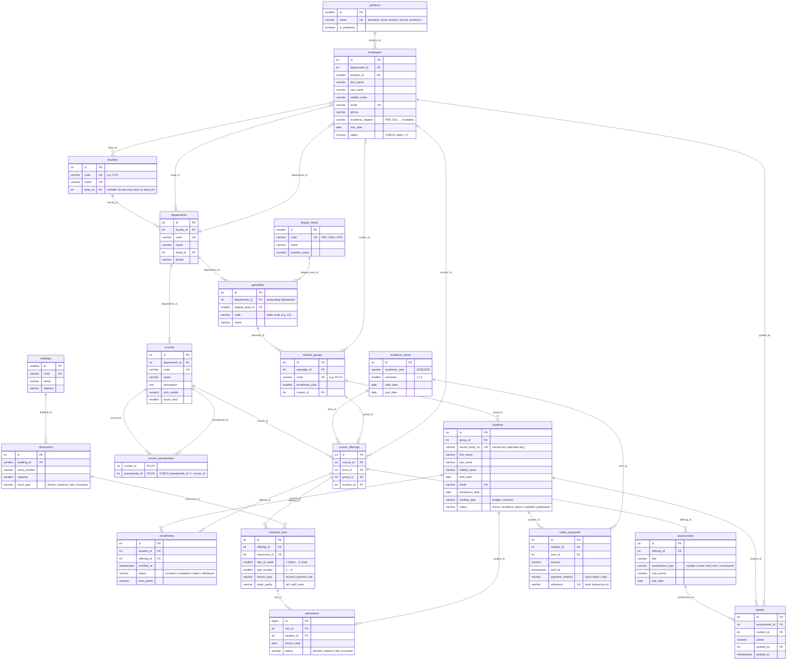

# ER diagram

> Generated from [`schema.dbml`](schema.dbml) by `python tools/dbml2mermaid.py`.
> The same DBML can be pasted into <https://dbdiagram.io/d> for an interactive view.

Entities: **20**, relationships: **30**.

